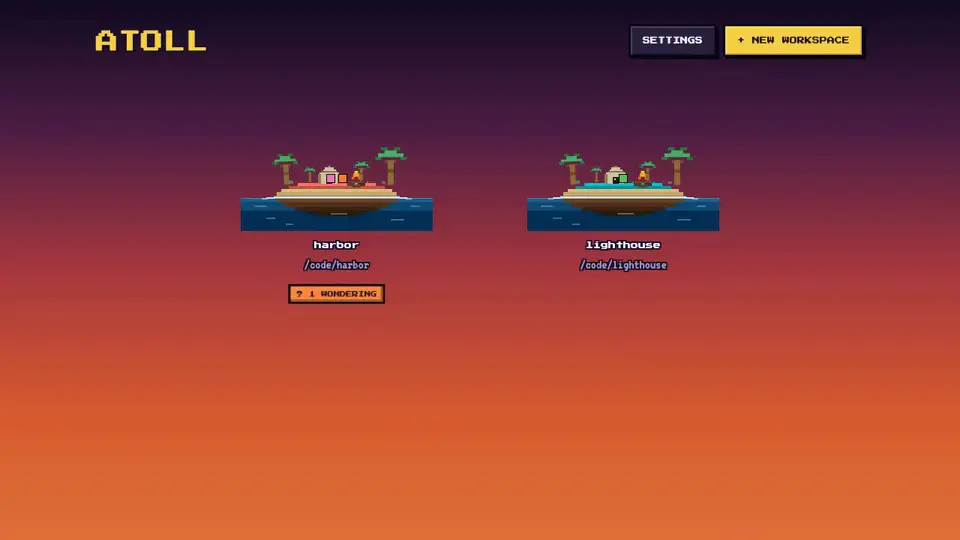

<p align="center">
  <a href="docs/demo.mp4">
    
  </a>
</p>

<h1 align="center">Atoll</h1>

<p align="center">
  A pixel sea for the agents Herdr is already running.<br>
  Herdr workspaces become islands. Agent panes become robots.<br>
  The terminal stays in Herdr. The island shows who is working.
</p>

<p align="center">
  <a href="docs/demo.mp4"></a>
  &nbsp;
  
  &nbsp;
  
</p>

The picture above is a short tour. Click it for the video file.

## Cast off

```bash
make
```

That installs dependencies, starts Atoll, and opens it in your browser. The API listens on this machine only.

| | Address |
| --- | --- |
| UI | http://127.0.0.1:5173 |
| API | http://127.0.0.1:8787 |

You need **Node 20+** and Herdr running on this machine (`herdr`). Pick the kind of agent to spawn under **SETTINGS**. Herdr starts that CLI.

<details>
<summary>The same steps without Make</summary>

```bash
npm run install:all
npm run dev
```

Then open http://127.0.0.1:5173.

</details>

## What you are looking at

| | |
| --- | --- |
| **Islands** | A Herdr workspace. The path under it is the folder those panes are in. |
| **Docks** | A Herdr tab. Shown when an island has more than one. |
| **Robots** | A pane where Herdr sees an agent. The kind can be Cursor, Claude, Codex, or any other Herdr knows. |
| **Terminal** | Stays in Herdr. Clicking a robot focuses that pane. |

## A short voyage

1. **+ NEW WORKSPACE** — name the island and point it at a folder. Herdr opens that workspace. `~/…` is fine.
2. Open the island and press **+ SPAWN AGENT**. Herdr starts the kind you chose in Settings.
3. Click a robot. Herdr focuses that pane, and the island zooms to a card with its job. **HIDE** or Esc returns you to the beach. The session keeps running.
4. Hover a sleeping robot and hand it a note, or answer one standing in the surf. **N** jumps to the next one waiting on you.
5. **+ ANOTHER** starts a neighbor on the same island. **DISMISS** closes that pane.

When an agent is blocked, the map shows **? N WONDERING**. That badge opens the reply. The ship's log under the chart is what the crew did after you opened Atoll.

## How a robot stands

| | Status | Meaning |
| --- | --- | --- |
| ⚙ | `working` | Herdr says the agent is working |
| ? | `needs-question` | Herdr says `blocked` |
| ✓ | `done` | Herdr says `done` (idle, and you have not looked yet) |
| z | `idle` | Herdr says `idle` |

Statuses come from Herdr.

## Under the hull

The sky setting is remembered in `~/.atoll/state.json`. Islands and robots come from the live Herdr session, so they survive an Atoll restart.

| Variable | What it changes |
| --- | --- |
| `PORT` | API port. Default `8787`. |
| `HERDR_SOCKET_PATH` | Herdr API socket. Default `~/.config/herdr/herdr.sock`. |

Behavior, layout, and the rules for changing this repo live in [docs/](docs/). Coding agents should start at [AGENTS.md](AGENTS.md).
