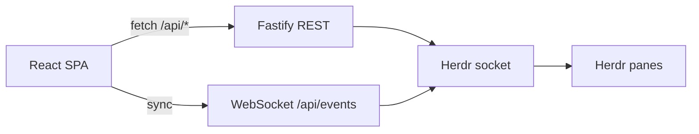

# Architecture

## Data flow

`server/src/herdr/session.ts` keeps one snapshot. Lifecycle events and per-pane `pane.agent_status_changed` events schedule a refresh. The browser hears `{ "type": "sync" }` and refetches. Settings (sky, default kind) still live in `~/.atoll/state.json`.

Spawn claims a shell pane in the workspace, or splits one, then calls `agent.start` with the default kind. Focus calls `agent.focus`. A note calls `agent.prompt`. A reply types with `pane.send_text` and submits with Enter. Dismiss calls `pane.close`. Deleting an island calls `workspace.close`.

Each fresh snapshot is diffed against the previous one. Pose changes, arrivals, and departures prepend the ship's log (48 lines, memory only). Summary-only edits stay out of the log.

## REST API

| Method | Path | Notes |
| --- | --- | --- |
| GET | `/api/health` | `{ ok, herdr }` |
| GET/PUT | `/api/settings` | Default kind is a Herdr agent name. Options come from `server.agent_manifests`. |
| GET/POST | `/api/workspaces` | POST body `{ name, path }` calls `workspace.create` with `focus: false` |
| DELETE | `/api/workspaces/:id` | `workspace.close` |
| GET | `/api/workspaces/:id` | One island, its docks, and its robots |
| POST | `/api/workspaces/:id/agents` | `agent.start` with the default kind |
| POST | `/api/workspaces/:id/agents/:agentId/focus` | `agent.focus` |
| POST | `/api/workspaces/:id/agents/:agentId/prompt` | `agent.prompt` when the robot is idle or done |
| POST | `/api/workspaces/:id/agents/:agentId/answer` | `pane.send_text`, then `pane.send_keys` `enter`, when the robot is blocked |
| DELETE | `/api/workspaces/:id/agents/:agentId` | `pane.close` |
| GET | `/api/log` | In-memory pose changes since this server started. The first snapshot writes nothing. |

A missing Herdr socket returns 503.

## WebSockets

### `/api/events`

- Server → client JSON: `{ "type": "sync" }` when the projected snapshot changes.
- Pages refetch REST on that message, on mount, after mutations, and once after the socket reconnects.
- Client helper: `client/src/lib/events.ts` (`subscribeAgentEvents`).

## Dev networking

- Vite (`5173`) proxies HTTP `/api` to `8787`.
- **WebSockets in dev** bypass the proxy: `wsUrl()` points at `ws://127.0.0.1:8787`.
- Server binds **`127.0.0.1` only** (`HOST` in `server/src/index.ts`).

## UI modes (workspace page)

- **Overview**: one island. Robots are grouped under a dock label when the workspace has more than one Herdr tab.
- **Focused**: CSS transition; the island fades; a large sprite sits beside the session card.
- Header **+ SPAWN AGENT** is disabled while focused. **+ ANOTHER** on the card starts a neighbor.
