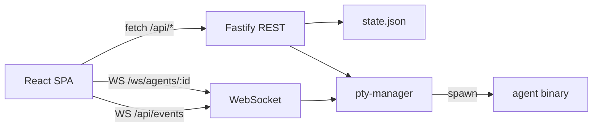

# Architecture

## Data flow

## REST API

| Method | Path | Notes |
| --- | --- | --- |
| GET | `/api/health` | `{ ok: true }` |
| GET/POST | `/api/workspaces` | POST body `{ name, path }`; path must be readable |
| DELETE | `/api/workspaces/:id` | Kills all PTYs in workspace |
| GET | `/api/workspaces/:id` | Single workspace + live status overlay |
| GET | `/api/workspaces/:id/agents` | Agent list |
| POST | `/api/workspaces/:id/agents` | Spawn PTY; optional `{ name }` |
| POST | `/api/workspaces/:id/agents/:agentId/sub` | Real child PTY (`parentId`, `source: 'pty'`) |
| DELETE | `/api/workspaces/:id/agents/:agentId` | Kill PTY + remove agent (+ children) |

Spawn goes through `server/src/cli/`. The default is stored in `state.json` settings and chosen in the SETTINGS dialog. A running agent keeps the CLI it was started with.

| CLI | Command | Binary |
| --- | --- | --- |
| `cursor` (default) | `agent --workspace <path> --trust` | `CURSOR_AGENT_BIN`, then `agent` |
| `claude` | `claude` with `cwd` set to the workspace | `CLAUDE_BIN`, then `claude` |

Each adapter also owns the text patterns for permission prompts and mirrored task sprites. The PTY lifecycle and status machine are shared.

## WebSockets

### `/ws/agents/:agentId`

- Bidirectional PTY bridge.
- Client → server JSON:
  - `{ "type": "resize", "cols", "rows" }`
  - `{ "type": "input", "data": "<string>" }`
- Plain string messages are also written to the PTY (legacy path).
- On connect: attach to existing session or spawn if missing; send `replay` buffer.
- **Refuse** attach/spawn when `agent.source === 'task'` (inferred Task child has no PTY).

### `/api/events`

- Server → client JSON: `{ "type": "status", "agentId", "status" }`, `{ "type": "exit", "agentId", "exitCode" }`, or `{ "type": "spawn", "agent" }` (inferred Task children).
- **Events-first refresh**: map and workspace pages subscribe here for badge updates. They fetch REST on mount, after spawn/dismiss/create/delete, and once after a socket reconnect. There is no interval poll.
- Client helper: `client/src/lib/events.ts` (`subscribeAgentEvents`).

## PTY manager

- One `Session` per agent id: `node-pty-prebuilt-multiarch` spawn, replay chunk ring (compacted to ~200k chars), socket fan-out.
- Permission scans use only the last ~8k of replay (see `permission-detect.ts`).
- Status-only `state.json` writes are debounced (~1s); create/delete/spawn persist immediately.
- **Idle timers** (`classifyPrompt` on the last ~8k only, not every chunk):
  - User keystrokes → `listening` (do not flip to `working`).
  - Agent output → `working`.
  - Quiet after `working`: permission → `needs-permission` at ~1.5s; question → `needs-question` at ~1.5s; else `done` at ~6s.
  - Quiet after `done` or `listening` → `idle` at ~20s.
- **Task children**: debounce (~400ms) when a chunk matches a cheap hint; `detectTaskChildren` on the last ~8k only (`task-detect.ts`). Cap ~8 per parent. Emit `spawn` + `status`. Never spawn a PTY for `source === 'task'`.
- **Do not** tear down PTY when UI hides terminal; only on dismiss, workspace delete, or process exit.

## Dev networking

- Vite (`5173`) proxies HTTP `/api` to `8787`.
- **WebSockets in dev** bypass the proxy: `wsUrl()` points at `ws://127.0.0.1:8787` because proxy upgrade was unreliable for PTY streams.
- Server binds **`127.0.0.1` only** (`HOST` in `server/src/index.ts`).

## UI modes (workspace page)

- **Overview**: island + all sprites; `focused === false`.
- **Focused**: CSS transition; island overview scaled/faded; split agent / terminal.
- Spawn and header **+ SPAWN AGENT** disabled while focused.
